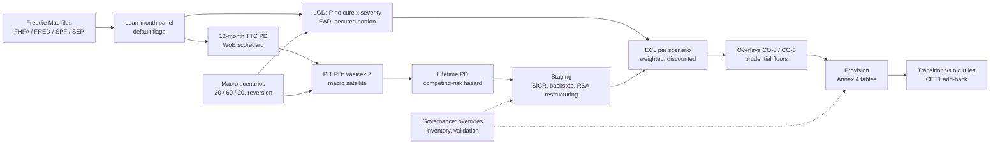

# ECL Engine — RBI 2026 Expected Credit Loss Directions

A Python engine that computes expected credit loss (ECL) for a housing-loan portfolio under the
Reserve Bank of India (Commercial Banks – Asset Classification, Provisioning and Income Recognition)
Directions, 2026 (issued 27 April 2026, effective 1 April 2027). It implements staging, 12-month and
lifetime ECL with probability-weighted macro scenarios, the prudential floors, the Annex 4
disclosures and the transition from the old provisioning rules, with maker-checker overrides and a
model inventory. It runs on the Freddie Mac Single-Family Loan-Level Dataset (1.375m loans, vintages
1999-2026) and includes an India adapter that runs the same engine on a synthetic Indian book.

> **Data notice.**
> - **Freddie Mac data is not included or redistributed in this repository.** Download the
>   Single-Family Loan-Level Dataset yourself from Freddie Mac, under Freddie Mac's terms of use.
>   Only aggregate results (no loan-level rows) are tracked.
> - Models are estimated on US data, so the results are **not Indian risk estimates**.
> - **The India results are synthetic** (a book derived from US loans with Indian product
>   features); they are **not real risk estimates** for any Indian lender.
> - Validation is developer self-validation, not independent validation.

## Key results

| | US book, 2026-03-31 | US book, 2023-03-31 | Synthetic India, 2026-03-31 |
|---|---|---|---|
| Loans (Stage 1 / 2 / 3) | 333,110 / 8,138 / 7,693 | 269,381 / 4,798 / 6,128 | 332,832 |
| Exposure | USD 82.3bn | USD 57.3bn | Rs 101,296 crore |
| Model ECL before floors | USD 154.7m | USD 75.8m | - |
| **Provision after floors (coverage)** | **USD 1,229.9m (1.49%)** | **USD 767.2m (1.34%)** | **Rs 468.8 crore (0.46%)** |
| Old-rules (IRACP) provision | USD 1,281.7m | USD 851.1m | Rs 395.4 crore |
| Transition impact (dry run) | 0 (ECL below the old rules) | 0 | Rs 73.4 crore |
| Gross NPA | - | - | 0.79% (calibrated to 0.8%) |

- The prudential floors set most of the provision: model ECL is 13% of the US provision.
- Restructured accounts are 65% of the US provision; their treatment rests on a reading of the
  Resolution of Stressed Assets Directions that needs compliance review (finding H-1).
- 12-month PD Gini 0.80 on the holdout, 0.69-0.75 out of time; ECL backtest (2023-03-31, next 12
  months): RBI defaults 1.11x the predicted count.

## Architecture



## Quickstart

```bash
git clone <this repository> && cd ecl-engine
python -m venv .venv && . .venv/bin/activate      # Windows: .venv\Scripts\activate
pip install -e ".[dev]"
pytest && ruff check .
```

Get the data yourself (it is not redistributed here):

- Freddie Mac sample files (`sample_orig_YYYY.txt`, `sample_perf_YYYY.txt`, Release 47) into `data/raw/`.
- US macro data into `data/macro/`: FHFA All-Transactions HPI by state (`hpi_at_state.csv`) and
  for the US (`USSTHPI.csv`); FRED series `A191RL1Q225SBEA` (real GDP growth), `MORTGAGE30US`,
  `UNRATE`, `FEDFUNDS`, `GS10`; the Philadelphia Fed SPF median forecasts (`medianGrowth.xlsx`,
  `medianLevel.xlsx`); the FOMC Summary of Economic Projections PDFs named in `config/scenarios.yaml`.
- For the India adapter, the RBI DBIE / MoSPI series listed in `config/india.yaml` into
  `data/macro/india/` (see [docs/india_adapter.md](docs/india_adapter.md)).

Then run the pipeline in order:

```bash
ecl build-panel                 # Module 1: loan-month panel and QC (~10 min)
ecl build-pd-dataset            # Module 2a
ecl train pd-12m                # Module 2b
ecl train pd-pit --rebuild-cells
ecl train pd-lifetime           # Module 3
ecl scenarios && ecl crisis-replay && ecl scenario-pd     # Module 4
ecl train lgd                   # Module 5
ecl run                         # Modules 6-8: staging, ECL, floors for every reporting date
ecl report                      # Module 10: Annex 4 tables and transition
ecl validate --date 2023-03-31  # Module 11: backtest and M-1 check
ecl india                       # Module 12: SYNTHETIC Indian book
ecl governance inventory        # Module 9: model inventory check
```

Fit commands (`ecl train`, `ecl scenarios`, `ecl crisis-replay`) run with one BLAS thread and
deterministic LightGBM, so identical inputs give bit-identical outputs. A full run takes about
2.5 hours on a laptop.

Every output records the git commit and clean-tree flag of the code that produced it. The
repository history was consolidated into a single commit at release, so commit hashes quoted in
the outputs, the model inventory and the model CHANGELOGs refer to the pre-release development
history.

## Documentation

- [Reviewer summary](docs/summary.md) — two pages.
- [Methodology](docs/methodology/) — one document per component: [data](docs/methodology/data.md),
  [12-month PD](docs/methodology/pd_12m.md), [PIT PD](docs/methodology/pd_point_in_time.md),
  [lifetime PD](docs/methodology/pd_lifetime.md), [scenarios](docs/methodology/scenarios.md),
  [LGD and EAD](docs/methodology/lgd_ead.md), [staging](docs/methodology/staging.md),
  [ECL and floors](docs/methodology/measurement_floors.md),
  [reporting and transition](docs/methodology/reporting_transition.md),
  [governance](docs/methodology/governance.md).
- [Regulatory mapping](docs/regulatory_mapping.md) — RBI paragraph → code → test.
- [Validation report](docs/validation_report.md) and the
  [limitations, overlays and findings register](docs/limitations.md).
- [India adapter](docs/india_adapter.md) (SYNTHETIC) · [Glossary](docs/glossary.md).
- RBI texts used: [docs/reference/](docs/reference/). Model CHANGELOGs and cards: `models/*/`.

## Licence

The code is released under the [MIT License](LICENSE). The licence covers this repository's code
and documentation only. It does not cover the Freddie Mac Single-Family Loan-Level Dataset, which
is not included here and is used under Freddie Mac's own terms, or the RBI texts in
`docs/reference/`.
